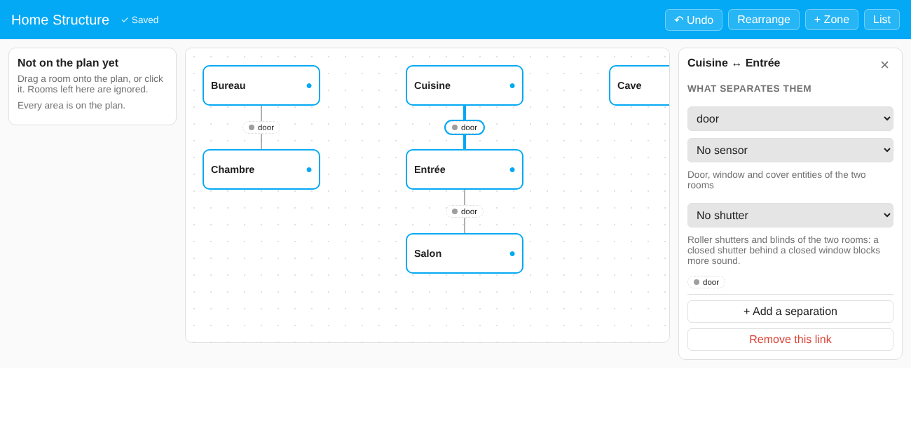
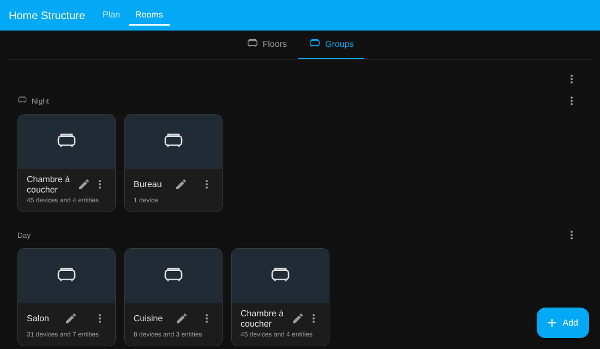

# Home Structure

A Home Assistant integration that describes **the structure of your home**: which spaces are next to each other, what separates them (open space, doorway, door, glass door, security grille, window, shutter, plain wall) and what the opening sensors say right now.

It does not do anything with sound, light, heat or presence. It only keeps the description of the home, so that any integration or automation can ask "is the living room open to the hall?" instead of each one asking you to describe your home again. [Sound Recognition](https://github.com/schawki/sound-recognition-ha) is the first one to use it.

*Français : [docs/README.fr.md](docs/README.fr.md)*



## Install

Requires Home Assistant 2025.8 or later and your rooms defined as areas.

1. HACS → Custom repositories → `https://github.com/schawki/ha-home-structure` (category: Integration) → install, restart Home Assistant.
2. Settings → Devices & services → Add integration → **Home Structure**.
3. Click **Configure** to describe your home.

## The model

- **Spaces.** A room is a Home Assistant area. A **zone** is a space that is not an ordinary room, and it can be:
  - *inside your home*: garden, balcony, terrace, courtyard, garage;
  - *outside it*: the hall or landing, the stairwell, a shared area of the building, the street, a neighbouring home.

  If a zone already exists as a Home Assistant area (a garden with a camera, a building hall with a doorbell), you give that area a kind and say whether it is part of the home; its devices stay where they are. Zones with no area (the street, the neighbour) are created in Home Structure.
- **Types of room.** An ordinary room can be given a type, chosen by you and never guessed from its name: organised in groups: sleeping (bedroom, master bedroom, child's bedroom, baby's room, guest room), living and leisure (living room, dining room, game room, home cinema, gym), work (office, workshop), bathrooms (bathroom, toilet), kitchen and utility (kitchen, pantry, laundry room, utility room, dressing room, storage, cellar, attic) and circulation (hallway, entrance, staircase). A garage is a kind of zone. A released type is never removed. It is optional, and only rooms have one. Integrations read it as `room_type` to adapt to what a room is used for.
- **Connections.** Two spaces that are next to each other are connected. Two spaces with no connection are not adjacent.
- **Separations.** A connection has one or more separations, and each has a type:

  | Type | Meaning | State |
  |---|---|---|
  | `open_space` | no separation at all (a living room and a hall in one space) | always open |
  | `opening` | a passage with no door | always open |
  | `door` | a door | from its sensor |
  | `glass_door` | glass or sliding door | from its sensor |
  | `grille` | security grille or mesh door: a physical barrier that hardly stops sound; you say whether people can pass | from its sensor if it has one |
  | `window` | a window (people can use it in an emergency or to break in, so you say whether it counts as a passage) | from its sensor |
  | `shutter` | roller shutter or blind (same choice as a window) | from its cover |
  | `wall` | a plain wall: adjacent, no passage | always closed |

  A door and a glass door between the same two spaces are two separations of one connection.
- **Passage.** Each separation says whether a person can go through it: `normal` (open space, opening, door, glass door, grille), `possible` (window, shutter: only in an emergency or by force) or `none` (wall). Passage describes the type, never the current state: a closed or locked door is still `normal`. For the three ambiguous types (`grille`, `window`, `shutter`) the editor lets you change the level. A connection's passage is the highest of its separations.
- **Locks.** A door, glass door or grille can name a `lock` entity, separate from its opening sensor (a bolt that is open does not mean the door is open). The attribute `lock_state` is `locked`, `unlocked`, `jammed` or `unknown`.
- **Sensors.** A separation that can change may have a `binary_sensor` (door or window contact) or a `cover` (shutter). Its state becomes `open`, `closed`, `partial` (a cover between 1 and 99 %, or moving) or `unknown` (no sensor, or it does not answer).
- **A shutter in front of a window or a door.** A door, glass door or window can also name the `cover` of the roller shutter or blind in front of it (the `shutter` field). The separation keeps its own state and reports the shutter next to it in the attributes `shutter`, `shutter_state` and `shutter_position`, so a consumer can combine the two. Use the separate `shutter` type only for a shutter that is the whole separation.

## Setting it up

Open **Home Structure** in the sidebar. You see a plan you arrange yourself, and everything you do is saved immediately and can be undone. The plan opens **locked** so that nothing changes by accident: you can look and select, but press **🔒 Locked** to unlock it before you edit.

1. **Add your rooms.** The left column lists the Home Assistant areas that are not on the plan yet. Click **Add all** (they are laid out in one column per floor, which you can then move around), or drag or click only the ones you want. Areas left in the column are ignored. Nothing is guessed from names.
2. **Move them** wherever makes sense to you, so the plan looks like your home. **Rearrange** lays everything out again by floor.
3. **Connect them.** Drag the ● handle of a room onto the room next to it. Click the link to say what separates them (open space, door, glass door, grille, window, shutter, wall…), pick the opening sensor from the door, window and cover entities of the two rooms, pick the shutter in front of a window or door if there is one, and add a second separation if there is another. The link shows the live state of each separation (open, closed, partly open).
4. **Give each room its type** in its panel (bedroom, nursery, gym, dressing room…), or leave it unspecified. One list covers rooms and outside spaces. In the same panel, tick the **usual occupants** of the room (Home Assistant users).
5. **Add what is outside** with **+ Zone**: garden, balcony, hall, stairwell, street, a neighbouring home… The kind decides whether the zone is part of the home; you can change it. A room can also be turned into a zone kind (an area named "Garage" can be marked as a garage), and a room can be split by creating a zone next to it.

The **Rooms** tab looks like Home Assistant's own Areas page. Rooms are shown as cards under their floor (lowest first); rooms with no floor come last. The **⋮** of a floor offers **Edit floor** and **Rearrange rooms**, the page menu offers **Rearrange floors**, and **+ Add** creates a floor or a room. The pencil of a card opens the same form as Home Assistant (name, icon, floor, labels, picture, aliases) plus the **usual occupants** of the room (the same ones as in the Plan tab) and everything is written to Home Assistant's own registries. Rooms can leave a floor but are never deleted here, and floors are not deleted either. The form also has an **Associated sensors** section: for each category (temperature and humidity always, plus any other category the room has) you can pick the chosen sensor, and **Order sensors** opens the order form with the Assist, Alexa and Google boxes. Clicking a card opens the page of the room: its sensors by type with the usual occupants, whether each sensor is exposed to Assist (set in Home Assistant, under Voice assistants), and whether it is exposed through HomeKit or Matter (badges). Diagnostic and configuration entities are hidden. HomeKit is read from the filters of your HomeKit entries; Matter is read from the Matter Hub add-on when it answers, and the Matter badge is simply left out when it cannot be read.

**Hidden by default.** Sound detections (Sound Recognition, Frigate audio, any binary sensor of class `sound`) and every sensor that is not a temperature, humidity, illuminance, CO2, pressure, sound pressure, particle, VOC, motion, occupancy or presence sensor are hidden; each room says how many. Two boxes at the top bring them back.

**Chosen sensor.** For each category of a room you can pick which sensor stands for it. By default it is the first one exposed to Assist. For temperature and humidity the choice is also written to the room in Home Assistant (a box turns this off), and a sensor set there is followed. Choosing never changes what is exposed to an assistant, and every choice can be undone from the history.

Changes made from the Rooms tab are behind three padlocks (**Assist**, **Rooms**, **Order**), all locked each time you open the panel, and only administrators can use them:

- **Assist, Alexa, Google.** The *Assist* box of a sensor is Home Assistant's own exposure (Settings, Voice assistants, Expose): ticking it there or here is the same thing, and Home Structure keeps no copy. *Alexa* and *Google* boxes only appear when they are enabled in Home Assistant Cloud, and are unticked unless you tick them. Each change asks for confirmation. Ticking Assist does not change the order of the sensors, and the order does not change what Assist uses.
- **Moving a sensor to another room** (the *Move…* button, also for sensors with no room). If the sensor belongs to a device that has other entities, you choose between moving *this sensor only* (it then has a room of its own) and *the whole device*. The confirmation lists the automations, scripts and scenes that use the sensor, the device or the rooms involved. Whatever is built by a template cannot be detected.
- **Order.** With two or more sensors of the same type in a room, move them with the arrows or by dragging; the first is the priority one that other integrations use first. Until you save an order, the sensor exposed to Assist comes first. *Default order* goes back to that.
- **History.** The 50 latest changes of exposure and room are listed with an *Undo* button, which refuses when the state has changed since.

On a narrow screen the plan becomes a list with the same editing. The older configuration screens (*Configure* on the integration) still work and edit the same data.

## Groups of rooms

The **Groups** view of the Rooms tab (the **Floors | Groups** switch at the top, like the tabs of Home Assistant's Areas page) gathers rooms into groups of your own: the bedrooms, the night part of the home, the rooms that face the street… Home Assistant only groups areas by floor; a group has no such limit, so a **room can be in several groups** (or in none), and nothing is guessed from names.



- The page works like the Areas page of Home Assistant: one section per group with a card per room (its icon, its name and what it holds, as on that page), **+ Add** at the bottom right to create a group or a room, and a ⋮ menu on each group (**Rearrange rooms**, **Edit group**, **Delete group**). The ⋮ menu at the top rearranges the groups themselves. Rearranging works by **dragging** (a card inside its group, a group by its header; it also works with a finger, Escape or releasing outside cancels, and the arrow keys move a focused handle). The order you choose is kept.
- The ⋮ menu of a room card **moves it to another group**, **adds it to another group**, **removes it from this group** or **from all groups**. Rooms in no group are listed at the bottom.
- **Edit group** has an ID (set when the group is created, never changed), a name, an icon, the rooms (chips, with **Add a room**), aliases and a *level* (stored, not used by anything yet). Aliases are other names for your own templates and scripts: they appear in the service and the attributes below; Assist does not read them.
- **Temperature and humidity.** For each, choose *No sensor*, *One sensor* (among those of the rooms of the group), *Average of all the sensors of the rooms* or *Average of a selection*. Diagnostic and configuration entities are never offered, and the dialog shows each source with its value. "All" is looked up every time, so a sensor moved to or from one of these rooms is followed automatically. Editing a group never reloads the integration: its sensors are updated on the spot. A group with a sensor gets a `sensor` entity (for example `sensor.home_structure_night_temperature`) with the attributes `group`, `mode`, `area_ids`, `sources` and `used_sources`. A source that is unavailable, not a number or absurd (a humidity above 100 %) is ignored rather than counted as zero; Fahrenheit and Kelvin sources are converted. If a room leaves a group, the sensors that are no longer in the group's rooms are taken out of its settings and the panel tells you.
- A group can be empty, and deleting a group never touches its rooms.

Use the rooms of a group wherever Home Assistant takes an area, by reading the list from the service:

```yaml
actions:
  - action: home_structure.get_groups
    response_variable: result
  - action: light.turn_off
    target:
      area_id: "{{ (result.groups | selectattr('id', 'eq', 'night') | first).area_ids }}"
```

Whether a device can act on areas depends on the device and its integration (a vacuum that cleans by room, for instance, depends on what its integration offers); Home Structure only supplies the list of areas.

Labels of Home Assistant also give several memberships and can be targeted, but they apply to anything. Groups only hold rooms, are arranged like floors, and can give a temperature and a humidity for the whole group.

## What you get

- **One sensor per separation**, for example `sensor.home_structure_living_room_building_hall_door`, with the state `open`, `closed` or `partial` (unknown when it cannot be read) and the attributes `type`, `space_a`, `space_b`, `name_a`, `name_b`, `sensor`, `position`, `passage`, `lock` and `lock_state`. Use it in automations, templates and dashboards.
- **A service** `home_structure.get_structure`, which returns the whole structure with current states, for integrations:

```yaml
action: home_structure.get_structure
response_variable: home
```

```yaml
spaces:
  - {id: "area:living_room", name: Living room, kind: room, room_type: living_room, in_home: true, area_id: living_room}
  - {id: "area:hall", name: Building hall, kind: hall, room_type: null, in_home: false, area_id: hall}
  - {id: "zone:street", name: Street, kind: street, room_type: null, in_home: false, area_id: null}
connections:
  - id: 1f3a9c2e
    a: "area:living_room"
    b: "area:hall"
    a_name: Living room
    b_name: Building hall
    separations:
      - {id: 7be41d90, type: door, state: open, position: null, sensor: binary_sensor.hall_door, entity_id: sensor.home_structure_living_room_building_hall_door, shutter: null, shutter_state: null, shutter_position: null, passage: normal, lock: null, lock_state: null}
    passage: normal
layout:   # positions on the editor plan, to draw it
  "area:living_room": {x: 24, y: 24}
  "area:hall": {x: 248, y: 24}
```

- **A service** `home_structure.get_adjacency`, which returns which areas are next to which, as a plain list per area, for integrations that want adjacent areas (for instance to copy them into another integration's settings):

```yaml
action: home_structure.get_adjacency
data:
  level: normal   # or "possible" to include windows and shutters
response_variable: adjacency
```

```yaml
adjacency:
  living_room: [hall, kitchen]
  hall: [living_room]
  bedroom: []
```

  Only areas appear (zones such as the street are left out), the relation is symmetric, and an area with no neighbour has an empty list. It is read-only: Home Structure does not write into other integrations' settings, and none reads it automatically yet, so copy the lists by hand where needed. The panel (not the options flow) manages shutters, locks and passage levels.
- **A service** `home_structure.get_groups`, which returns the groups of rooms: `id`, `name`, `level`, `icon`, `aliases`, `area_ids`, `areas` (id and name) and, for `temperature` and `humidity`, the `mode`, the `entities` chosen and the `entity_id` of the group sensor (null without one).
- **A service** `home_structure.get_occupants`, which returns the usual occupants of the rooms: `rooms` (`{area id: [user id]}`) and `users` (each user's `id`, `name`, `person_entity_id` when a person is linked to the user, and `area_ids`, the rooms they usually use). Set them in the plan: select a room and tick the users. Another integration, such as a dashboard, can use them.
- **A service** `home_structure.get_room_sensors`, which returns, for each room, its sensors and binary sensors grouped by type (`rooms[].types[]`: `type`, `domain`, `sensors`, `ordered`, `assist_first`), the `occupants` of the room, and the sensors that are in no area (`unassigned`). Each sensor carries `assist` (exposed to Assist), `homekit` and `matter` (the names of the bridges that expose it). When a type has two or more sensors, `ordered` is true and the list order is the priority; until an order is saved, the sensor exposed to Assist comes first. Each type also carries `primary` (the sensor chosen for that category in the room) and `primary_source` (`native`, `chosen` or `assist`), and each sensor `hidden` (`sound`, `other` or null: sound detections and sensors that do not describe a room are hidden by default in the panel, but are still returned). `matter.available` is false when the Matter Hub add-on could not be read; no sensor then carries a Matter name.
- **A service** `home_structure.get_room_entities`, which returns the other entities of each room by type (`rooms[].entities`: `{domain: [{entity_id, name, state, device_id, device_name}]}`), and those that are in no area (`unassigned`). Lights, media players, switches, climate and so on: Home Structure only says what is in each room, and what it means is for the integration that reads it. Without a parameter every type is returned except `sensor` and `binary_sensor` (they have `get_room_sensors`); pass `domains: [media_player, light]` to keep only those types, sensors included if you name them. The room of an entity is its own, or else the one of its device; diagnostic, configuration, disabled and hidden entities are left out.

- **An event** `home_structure_changed`, fired when the structure or the groups are saved and when the integration is loaded (this includes a save made in the options flow). It carries only `reason` (`saved_structure`, `saved_groups` or `loaded`): an integration that keeps a copy of the structure listens to it and calls `get_structure`, `get_groups` or `get_adjacency` again.

For an integration, reading the structure goes through this service and the `entity_id` of each separation: nothing to import, nothing to install beyond Home Structure.

## Using it in an automation

Each separation is a sensor, so the state of a door between two rooms is available like any other entity:

```yaml
triggers:
  - trigger: state
    entity_id: sensor.home_structure_living_room_building_hall_door
    to: open
actions:
  - action: notify.mobile_app_phone
    data: {message: "The door to the building hall is open."}
```

## Used by Sound Recognition

[Sound Recognition](https://github.com/schawki/sound-recognition-ha) reads the structure to know how much a sound passes from one room to the next (an open door lets it through, a closed door or shutter muffles it, a wall nearly stops it) and to include the devices of connected rooms. It is optional for Sound Recognition, and Home Structure does not need it.

## Troubleshooting

- *A room does not appear in the list on the left*: it is not a Home Assistant area yet, or it is already on the plan.
- *A separation shows `unknown`*: it has no sensor, or its sensor is unavailable. Doors and windows without a sensor stay `unknown`; only open spaces, openings and walls have a fixed state.
- *The sensor of a separation is not in the list*: only door, window and cover entities of the two rooms are offered; assign the entity to the right area first.
- *Everything looks wrong after a change*: use **Undo** in the panel; every change is saved immediately and can be undone.

## Languages

English is the reference. French is included. To add a language, see [CONTRIBUTING.md](CONTRIBUTING.md): it is one file to copy and translate.

## Status

Version 0.7, tested (backend and panel test suites run on every commit) and used with Sound Recognition. The home is described in the **Home Structure** panel of the sidebar (a plan you arrange, with autosave and undo); the *Configure* menus of the integration remain as a fallback. Groups of rooms are in the **Groups** tab. Feedback and issues are welcome.

## Licence

MIT.
